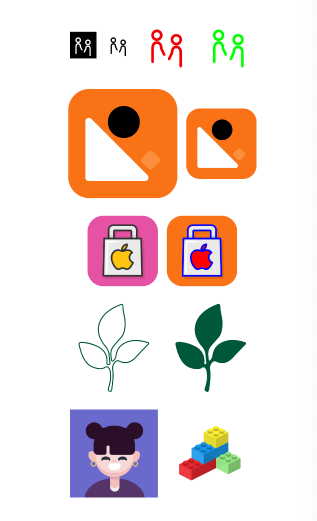

# SVGImage

## 简介
RangeSlider是基于open harmony基础组件开发的双滑块范围选择组件。

## 下载安装
```
ohpm install @flat/range_slider
```
或在`oh-package.json5`配置如下：
```
{
  "dependencies": {
    "@flat/range_slider": "latest",
  }
}
```


## 效果



## 接口说明

| 名称                   | 描述           | 参数类型             | 是否必需        |
|:---------------------|:-------------|:-----------------|:------------|
| values               | 当前滑动范围值      | [number, number] | 否，默认[0,100] |
| max                  | 最大值          | number类型         | 否，默认100     |
| min                  | 最小值          | number类型         | 否，默认0       |
| step                 | 步长           | number类型         | 否, 默认0      |
| minDistance          | 滑块间的最小距离     | number类型         | 否, 默认0      |
| trackStyle           | 轨道样式         | SliderTrackStyle | 否           |
| trackHighlightStyle  | 高亮轨道样式       | SliderTrackStyle | 否           |
| isAlignment          | 轨道两端是否与滑块对齐  | boolean          | 否，默认true    |
| allowRange           | 允许滑动的范围      | SlideRange       | 否           |
| thumbLeft            | 自定义左滑块       | CustomBuilder    | 否           |
| thumbRight           | 自定义右滑块       | CustomBuilder    | 否           |
| onValuesChange       | 滑动事件，滑动时调用   | Event            | 否           |
| onValuesChangeFinish | 滑动事件，滑动结束时调用 | Event            | 否           |


## API限制

* SDK: API12 (5.0.0)

## 使用示例

```c
// 默认展示
SVGImage({source: $rawfile('visitor_icon.svg')}).backgroundColor(Color.Black)

// 设置颜色大小
SVGImage({source: $rawfile('visitor_icon.svg'), bounds: 60, stroke: '#f00000'})

// 颜色值替换
SVGImage({source: $rawfile('visitor_icon.svg'), bounds: 60, colorSwap: {'#FFFFFF': '#00FF00'}})

// 颜色填充设置
SVGImage({source: $rawfile('line.svg'), bounds: 100, fill: '#00583b'})

// 根据ID修改颜色
SVGImage({
  source: $rawfile('svg_clock.svg'), 
  bounds: 80,
  idStyles: {
    "Bg": { fill: '#F97316'}
  },
  colorSwap: {"#FFC50D": "#FF0000", '#333333': '#0000FF'}
})

```

## License
This project is licensed under Apache License 2.0.
