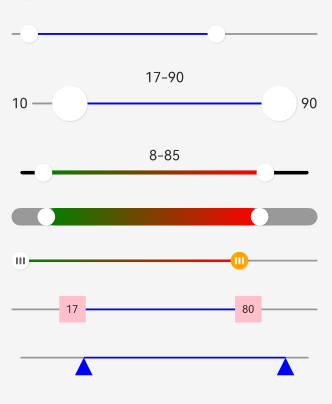

# RangeSlider

## 简介
RangeSlider是基于open harmony基础组件开发的双滑块范围选择组件。

## 下载安装
```
ohpm install @flat/range_slider
```
或在`oh-package.json5`配置如下：
```
{
  "dependencies": {
    "@flat/range_slider": "latest",
  }
}
```


## 效果



## 接口说明

| 名称                   | 描述           | 参数类型             | 是否必需        |
|:---------------------|:-------------|:-----------------|:------------|
| values               | 当前滑动范围值      | [number, number] | 否，默认[0,100] |
| max                  | 最大值          | number类型         | 否，默认100     |
| min                  | 最小值          | number类型         | 否，默认0       |
| step                 | 步长           | number类型         | 否, 默认0      |
| minDistance          | 滑块间的最小距离     | number类型         | 否, 默认0      |
| trackStyle           | 轨道样式         | SliderTrackStyle | 否           |
| trackHighlightStyle  | 高亮轨道样式       | SliderTrackStyle | 否           |
| isAlignment          | 轨道两端是否与滑块对齐  | boolean          | 否，默认true    |
| allowRange           | 允许滑动的范围      | SlideRange       | 否           |
| thumbLeft            | 自定义左滑块       | CustomBuilder    | 否           |
| thumbRight           | 自定义右滑块       | CustomBuilder    | 否           |
| onValuesChange       | 滑动事件，滑动时调用   | Event            | 否           |
| onValuesChangeFinish | 滑动事件，滑动结束时调用 | Event            | 否           |


## API限制

* SDK: API12 (5.0.0)

## 使用示例

```
    
  @Local values1: [number,number] = [0,90];
  @Local values2: [number,number] = [0,100];
  @Local values3: [number,number] = [10,80];

  @LocalBuilder
  customThumbBuilder(isLeft: boolean) {
    if(isLeft) {
      CustomThumb()
    }else{
      CustomThumb({
        color: Color.Orange,
        lineColor: Color.White
      })
    }
  }

  @LocalBuilder
  customThumbBuilder1(isLeft: boolean) {
    if(isLeft) {
      Column(){
        Text(`${this.values3[0]}`).fontSize(12)
      }
      .justifyContent(FlexAlign.Center)
      .width(30)
      .height(30)
      .backgroundColor(Color.Pink)
    }else{
      Column(){
        Text(`${this.values3[1]}`).fontSize(12)
      }
      .justifyContent(FlexAlign.Center)
      .width(30)
      .height(30)
      .backgroundColor(Color.Pink)
    }
  }

  @LocalBuilder
  customThumbBuilder2() {
    Column(){
      Polygon()
        .width(20)
        .height(20)
        .points([[10, 0], [20, 20], [0, 20]])
        .fill(Color.Blue)
        .translate({y: 10})
    }
  }

  build() {
    NavDestination(){
      Scroll(){
        Column({space: 30}){
          // 默认
          RangeSlider()
          Column(){
            Text(`${this.values1[0]}-${this.values1[1]}`)
            // 设置最大最小值
            Row({space: 5}){
              Text('10')
              RangeSlider({
                values: this.values1,
                max: 90,
                min: 10,
                thumbSize: 40,
                onValuesChange:(values: [number,number])=>{
                  this.values1 = values;
                }
              })
                .layoutWeight(1)
              Text('90')
            }
          }

          Column(){
            Text(`${this.values2[0]}-${this.values2[1]}`)
            RangeSlider({
              isAlignment: false,
              trackStyle: {
                height: 4,
                backgroundColor: Color.Black
              },
              trackHighlightStyle: {
                height: 5,
                linearGradient: {
                  direction:GradientDirection.Right,
                  colors: [
                    [Color.Green, 0],
                    [Color.Red, 1],
                  ]
                }
              },
              onValuesChange:(values: [number,number])=>{
                this.values2 = values;
              }
            })
          }
          RangeSlider({
            trackStyle: {
              height: 20,
            },
            trackHighlightStyle: {
              height: 20,
              linearGradient: {
                direction:GradientDirection.Right,
                colors: [
                  [Color.Green, 0],
                  [Color.Red, 1],
                ]
              }
            },
          })

          // 自定义滑块
          RangeSlider({
            trackHighlightStyle: {
              height: 3,
              linearGradient: {
                direction:GradientDirection.Right,
                colors: [
                  [Color.Green, 0],
                  [Color.Red, 1],
                ]
              }
            },
            thumbLeft: ()=>{this.customThumbBuilder(true)},
            thumbRight: ()=>{this.customThumbBuilder(false)},
          })
          // 自定义滑块 + 值显示
          RangeSlider({
            values: this.values3,
            thumbLeft: ()=>{this.customThumbBuilder1(true)},
            thumbRight: ()=>{this.customThumbBuilder1(false)},
            onValuesChange:(values: [number,number])=>{
              this.values3 = values;
            }
          })

          // 自定义三角滑块
          RangeSlider({
            isAlignment: false,
            thumbLeft: ()=>{this.customThumbBuilder2()},
            thumbRight: ()=>{this.customThumbBuilder2()},
          })

        }
        .padding(20)
        .width('100%')
      }
      .width('100%')
      .align(Alignment.TopStart)
      .layoutWeight(1)
      .edgeEffect(EdgeEffect.Spring, {alwaysEnabled: true})
    }
    .title('RangeSlider')
    .backgroundColor('#F5F5F5')

```

## License
This project is licensed under Apache License 2.0.
